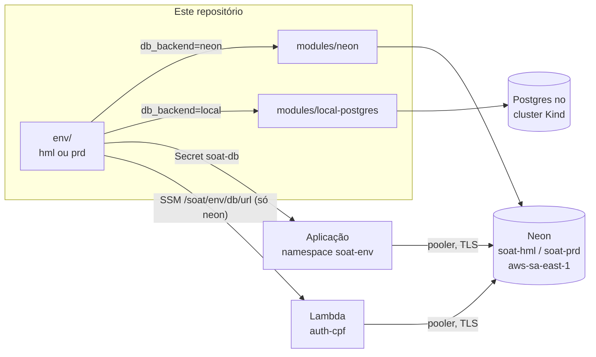

# soat-infra-db

Infraestrutura do banco de dados da oficina, parte da Fase 3 do Tech Challenge 13SOAT:
**PostgreSQL gerenciado no Neon**, provisionado por Terraform, um projeto por ambiente.

| Repositório | Papel |
|---|---|
| [fiap-software-architecture](https://github.com/gomes-leonardo/fiap-software-architecture) | Aplicação principal (NestJS) no Kubernetes |
| [soat-auth-lambda](https://github.com/gomes-leonardo/soat-auth-lambda) | Funções serverless: autenticação por CPF e notificação |
| [soat-infra-k8s](https://github.com/gomes-leonardo/soat-infra-k8s) | Cluster Kubernetes, gateway Kong e observabilidade |

A justificativa da escolha do PostgreSQL e o modelo ER estão no repositório da aplicação:
[justificativa do PostgreSQL](https://github.com/gomes-leonardo/fiap-software-architecture/blob/main/docs/database/justificativa-postgresql.md)
e [modelo ER e relacionamentos](https://github.com/gomes-leonardo/fiap-software-architecture/blob/main/docs/database/modelo-er.md).

## Arquitetura



O contrato com quem consome é um só: o **Secret `soat-db`** no namespace do ambiente, com
`DB_HOST`, `DB_PORT`, `DB_NAME`, `DB_USER`, `DB_PASS`, `DB_SSL` e `DB_MIGRATION_HOST`. A aplicação
lê esse Secret e não sabe qual banco está do outro lado.

| Chave | Neon | Postgres local |
|---|---|---|
| `DB_HOST` | host do **pooler** (PgBouncer) | Service `soat-db-pg` |
| `DB_MIGRATION_HOST` | host **direto**, sem pooler: DDL não passa pelo modo transação | o mesmo Service |
| `DB_SSL` | `true` | `false` |

No modo `neon`, a URL também vai para o SSM (`/soat/<env>/db/url`), porque a Lambda não enxerga o
cluster.

### Por que dois modos

O Neon é o banco gerenciado da entrega. O modo `local` é o equivalente até a conta do Neon
existir: o mesmo pipeline, o mesmo Secret, a aplicação já rodando. A troca é uma variável do
repositório (`DB_BACKEND=neon`) e um novo deploy. As migrations rodam no Job da aplicação contra o
banco novo.

## Tecnologias

Terraform (providers `kislerdm/neon`, `hashicorp/kubernetes`, `hashicorp/aws`, `hashicorp/random`), Neon PostgreSQL 16,
GitHub Actions com runner self-hosted e OIDC na AWS.

**Custo zero:** plano gratuito do Neon, com 100 CU-hora por projeto por mês, 0,5 GB e suspensão
após 5 minutos ocioso. Um projeto por ambiente dá a cada um a sua cota. O histórico de restore fica
em 6 horas, o máximo do plano gratuito.

## Deploy

| Evento | O que roda |
|---|---|
| Pull request para `develop` ou `main` | `terraform fmt -check` e `validate` de `env/` e `reference/aws-rds/` (GitHub-hosted) |
| Push em `develop` | `terraform apply` do ambiente **hml**, no runner self-hosted |
| Push em `main` | `terraform apply` do ambiente **prd** |

Pré-requisitos: o runner self-hosted com label `soat-kind` (no Mac onde roda o Kind), o cluster do
`soat-infra-k8s` de pé, e a variável `AWS_ROLE_ARN` criada pelo bootstrap do `soat-auth-lambda`.
Os Environments `hml` e `prd` ficam presos às branches `develop` e `main`, como nos outros
repositórios.

### Ativar o Neon

1. Criar a conta em [neon.com](https://neon.com) e gerar uma API key.
2. Cadastrar a chave e trocar o modo:
   ```bash
   gh secret set NEON_API_KEY
   gh variable set DB_BACKEND --body neon
   ```
3. Disparar um novo deploy em `develop` e depois em `main`. Em seguida, fazer um redeploy da
   aplicação, para o Job de migration criar o schema no Neon.

### Execução manual

Precisa de credencial AWS (o backend é S3, e o provider AWS sempre carrega) e do contexto
`kind-soat` no kubeconfig.

```bash
terraform -chdir=env init \
  -backend-config="bucket=tfstate-backend-fiap-leo" \
  -backend-config="key=soat-infra-db/env/hml/terraform.tfstate"
terraform -chdir=env apply -var environment=hml -var db_backend=local
```

## Links

- Swagger da API: [docs/swagger.json](https://github.com/gomes-leonardo/fiap-software-architecture/blob/main/docs/swagger.json)
- Postman: [docs/postman-collection.json](https://github.com/gomes-leonardo/fiap-software-architecture/blob/main/docs/postman-collection.json)
- Deploys: o resumo de cada run nas [execuções do Actions](https://github.com/gomes-leonardo/soat-infra-db/actions) mostra o ambiente e o backend aplicado. O projeto Neon
  de cada ambiente aparece no console do Neon como `soat-hml` e `soat-prd`.
